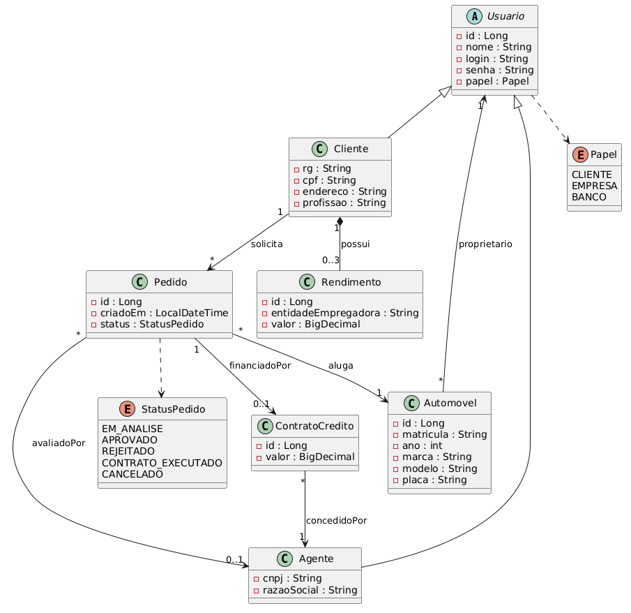
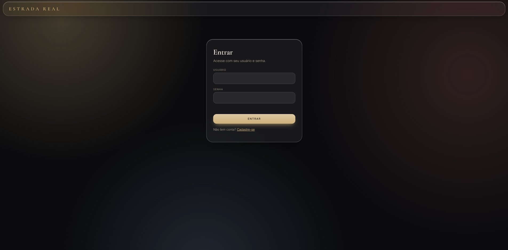
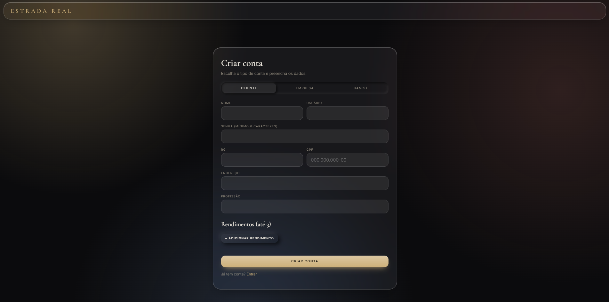
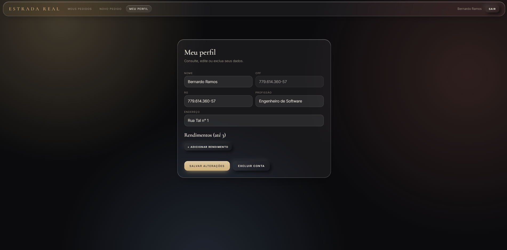
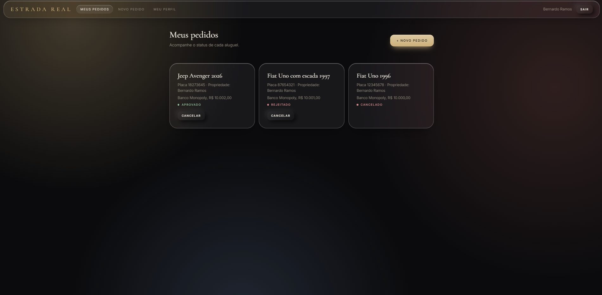
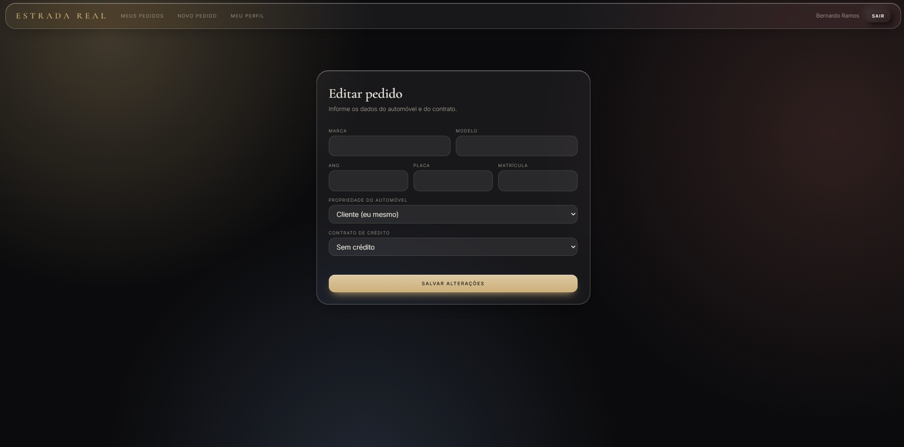
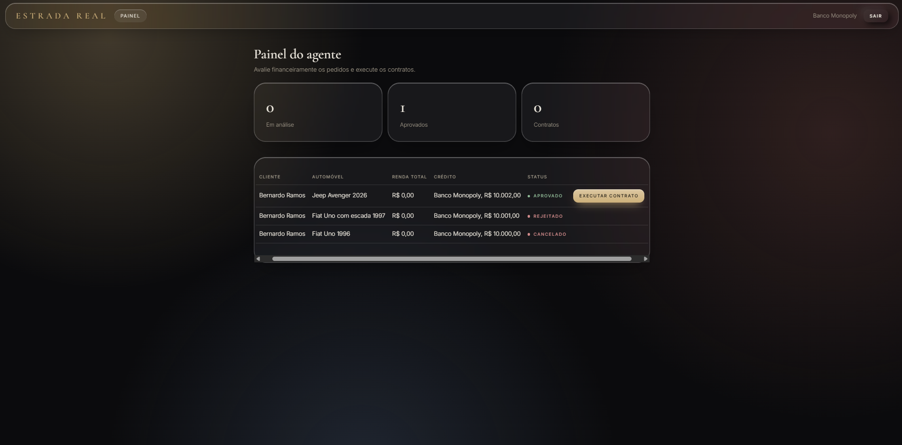
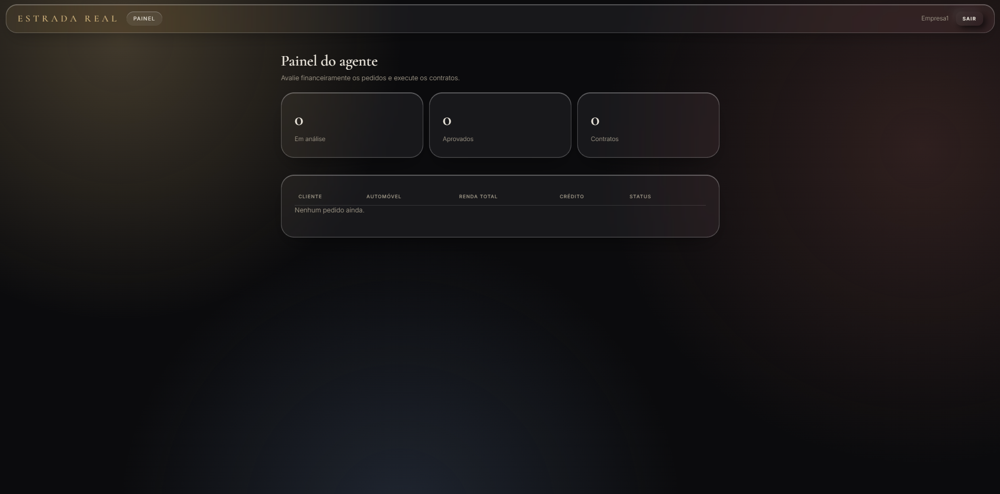

# 🚗 Estrada Real 👨‍💻

> [!NOTE]
> Sistema web de gestão de aluguéis de automóveis: o cliente cria, modifica, consulta e cancela pedidos pela Internet, e empresas e bancos avaliam os pedidos e executam os contratos.

---

## 🚧 Status do Projeto

      

---

## 📚 Índice
- [Links Úteis](#-links-úteis)
- [Sobre o Projeto](#-sobre-o-projeto)
- [Funcionalidades Principais](#-funcionalidades-principais)
- [Tecnologias Utilizadas](#-tecnologias-utilizadas)
- [Arquitetura](#-arquitetura)
- [Instalação e Execução](#-instalação-e-execução)
- [Estrutura de Pastas](#-estrutura-de-pastas)
- [Demonstração](#-demonstração)
- [Testes](#-testes)
- [Documentações utilizadas](#-documentações-utilizadas)
- [Autores](#-autores)
- [Agradecimentos](#-agradecimentos)

---

## 🔗 Links Úteis
* 💻 **Repositório:** [github.com/bernardorf5/estrada-real](https://github.com/bernardorf5/estrada-real)
* 📖 **Documentação e modelos UML:** pasta [`docs/`](./docs)

---

## 📝 Sobre o Projeto
O **Estrada Real** é o Laboratório 02 da disciplina de Desenvolvimento e Integração de Aplicações Web (DIAW), do curso de Engenharia de Software da PUC Minas.

Ele simula um sistema de apoio à gestão de aluguéis de automóveis. O cliente se cadastra, informa seus dados e rendimentos e faz pedidos de aluguel, que podem estar associados a um contrato de crédito de um banco. Empresas e bancos (os agentes) analisam o pedido do ponto de vista financeiro e, em caso de parecer positivo, executam o contrato.

O objetivo acadêmico é praticar o back-end em Spring Boot, front-end em React e banco de dados na nuvem, mantendo o código alinhado aos modelos UML.

---

## ✨ Funcionalidades Principais

- 🔐 **Autenticação:** cadastro e login obrigatórios, com senhas armazenadas em hash (BCrypt) e rotas protegidas por papel (cliente, empresa e banco).
- 👤 **CRUD de cliente:** cadastro, consulta, edição e exclusão, com até 3 rendimentos por cliente.
- 🚘 **Pedidos de aluguel:** o cliente cria, modifica (enquanto em análise), consulta e cancela pedidos, com dados do automóvel, proprietário e contrato de crédito opcional.
- 🏦 **Painel do agente:** análise financeira dos pedidos, com aprovação, rejeição e execução do contrato. Cada banco vê apenas os pedidos com crédito do próprio banco; a empresa vê os pedidos sem crédito ou de automóveis de sua propriedade.
- 📊 **Acompanhamento de status:** Em análise, Aprovado, Rejeitado, Contrato executado e Cancelado.

---

## 🛠 Tecnologias Utilizadas

### 💻 Front-end
* **Biblioteca:** React 19
* **Linguagem:** JavaScript (ES6+)
* **Roteamento:** React Router
* **Estilização:** CSS puro (glassmorphism com toques de neomorfismo)
* **Build Tool:** Vite 7

### ⚙️ Back-end
* **Linguagem:** Java (JDK 25)
* **Framework:** Spring Boot 4.0.x (Web MVC, Data JPA, Validation, Security)
* **Build e dependências:** Apache Maven

### 🗄️ Banco de Dados
* **SGBD:** PostgreSQL hospedado no Supabase

---

## 🏛 Arquitetura

O back-end segue a arquitetura **MVC em camadas**: o *controller* recebe as requisições, o *service* aplica as regras de negócio, o *repository* acessa o banco e o *model* representa as entidades. O front-end consome a API REST em JSON.

### Diagrama de Classes


### Demais modelos UML
* [Diagrama de Casos de Uso](docs/diagrama-de-casos-de-uso.puml)
* [Histórias do Usuário](docs/historias-de-usuario.md)
* [Diagrama de Pacotes](docs/diagrama-de-pacotes.puml)
* [Diagrama de Classes (código PlantUML)](docs/diagrama-de-classes.puml)

---

## 🚀 Instalação e Execução

### Pré-requisitos
* **JDK 25**
* **Node.js 20.19 ou superior** (com npm)
* Um projeto no **Supabase** (plano gratuito)
* Não é necessário instalar o Maven, pois o projeto usa o Maven Wrapper (`mvnw`)

### 🔑 Variáveis de Ambiente

#### 1 Back-end (Spring Boot)
Crie o arquivo `estrada-real-api/.env` (ele não vai para o GitHub) com a connection string do Supabase, na opção **Session pooler**, aba **JDBC**:

```env
SUPABASE_DB_URL=jdbc:postgresql://<host>.pooler.supabase.com:5432/postgres?user=postgres.<ref>&password=<senha>&sslmode=require
```

#### 2 Front-end (React, Vite)
Opcional. Por padrão, o front-end usa `http://localhost:5173`. Para mudar, copie `estrada-real-web/.env.example` para `.env`.

### 📦 Instalação de Dependências

#### Front-end (React)
```bash
cd estrada-real-web
npm install
```

#### Back-end (Spring Boot)
```bash
cd estrada-real-api
./mvnw dependency:resolve
```

### 🗃 Inicialização do Banco de Dados (PostgreSQL)
No painel do Supabase, abra o **SQL Editor**, cole o conteúdo de [`db/schema.sql`](./db/schema.sql) e execute. Serão criadas as 7 tabelas: `usuario`, `cliente`, `agente`, `rendimento`, `automovel`, `contrato_credito` e `pedido`.

### ▶️ Como Executar a Aplicação

#### Terminal 1: Back-end (Spring Boot)
Defina a variável de ambiente com o valor do seu `.env` e inicie. No PowerShell:

```powershell
cd estrada-real-api
$env:SUPABASE_DB_URL="jdbc:postgresql://..."
./mvnw spring-boot:run
```

No VS Code, também é possível usar a configuração **Estrada Real API** do `.vscode/launch.json`, que lê o `.env` automaticamente. A API sobe em `http://localhost:8080`.

#### Terminal 2: Front-end (React, Vite)
```bash
cd estrada-real-web
npm run dev
```
Acesse `http://localhost:5173`.

---

## 📂 Estrutura de Pastas

```
estrada-real/
├── .vscode/                  # configuração de execução no VS Code
├── db/
│   └── schema.sql            # criação das tabelas no Supabase
├── docs/                     # modelos UML e histórias do usuário
├── estrada-real-api/         # back-end (Spring Boot)
│   └── src/main/java/com/estradareal/estrada_real_api/
│       ├── controller/       # endpoints REST
│       ├── service/          # regras de negócio
│       ├── repository/       # acesso ao banco (JPA)
│       ├── model/            # entidades
│       ├── dto/              # objetos de entrada e saída da API
│       └── security/         # login e controle de acesso
├── estrada-real-web/         # front-end (React + Vite)
│   └── src/
│       ├── pages/            # telas
│       ├── components/       # componentes reutilizáveis
│       ├── api.js            # chamadas à API
│       └── auth.jsx          # contexto de autenticação
├── teste.http                # requisições de teste da API
└── README.md
```

---

## 🎬 Demonstração

### 🖥️ Aplicação Web

#### 🔐 1. Autenticação (login obrigatório)

| Login | Cadastro |
|:-----:|:--------:|
|  |  |
| `tela-login.png` | `tela-cadastro.png` |

#### 👤 2. CRUD de cliente

O cadastro (criar) está na tela de cadastro acima. Consulta, edição e exclusão ficam no perfil.

<!-- PRINT PENDENTE -->
**Perfil do cliente** (`docs/prints/tela-perfil.png`)



#### 🚘 3. Pedidos de aluguel (cliente)

<!-- PRINT PENDENTE -->
**Novo pedido** (`docs/prints/tela-novo-pedido.png`)


<!-- PRINT PENDENTE -->
**Meus pedidos, com o status de cada um** (`docs/prints/tela-meus-pedidos.png`)



<!-- PRINT PENDENTE -->
**Modificação de pedido em análise** (`docs/prints/tela-editar-pedido.png`)



#### 🏦 4. Avaliação dos pedidos (agentes: bancos e empresas)

<!-- PRINT PENDENTE -->
**Painel do banco: só aparecem os pedidos com crédito do próprio banco** (`docs/prints/tela-painel-banco.png`)



<!-- PRINT PENDENTE -->
**Painel da empresa** (`docs/prints/tela-painel-empresa.png`)



---

### 💻 Exemplo de Saída no Terminal (API)

Cadastro de um cliente:

```bash
curl -X POST http://localhost:8080/api/auth/register/cliente \
  -H "Content-Type: application/json" \
  -d '{"nome":"Maria Souza","login":"maria","senha":"123456","rg":"MG-12.345.678","cpf":"123.456.789-00","endereco":"Rua das Flores, 100","profissao":"Analista","rendimentos":[{"entidadeEmpregadora":"Empresa X","valor":6200}]}'
```

**Saída Esperada (HTTP 201):**
```json
{
  "id": 1,
  "nome": "Maria Souza",
  "login": "maria",
  "rg": "MG-12.345.678",
  "cpf": "123.456.789-00",
  "endereco": "Rua das Flores, 100",
  "profissao": "Analista",
  "rendimentos": [
    { "entidadeEmpregadora": "Empresa X", "valor": 6200 }
  ]
}
```

---

## 🧪 Testes

As requisições da API podem ser testadas pela extensão **REST Client** do VS Code, usando o arquivo [`teste.http`](./teste.http).

---

## 🔗 Documentações utilizadas

* 📖 [Spring Boot](https://docs.spring.io/spring-boot/docs/current/reference/html/)
* 📖 [Spring Data JPA](https://docs.spring.io/spring-data/jpa/reference/)
* 📖 [Spring Security](https://docs.spring.io/spring-security/reference/)
* 📖 [React](https://react.dev/reference/react)
* 📖 [React Router](https://reactrouter.com/)
* 📖 [Vite](https://vitejs.dev/config/)
* 📖 [Supabase: conexão com o banco](https://supabase.com/docs/guides/database/connecting-to-postgres)
* 📖 [PlantUML](https://plantuml.com/)
* 📖 [Conventional Commits](https://www.conventionalcommits.org/en/v1.0.0/)

---

## 👥 Autores

| 👤 Nome | 🖼️ Foto |       GitHub    |
|---------|----------|-----------------|
| Bernardo Ramos Ferreira | <div align="center"></div> | <div align="center"><a href="https://github.com/bernardorf5"></a></div> |